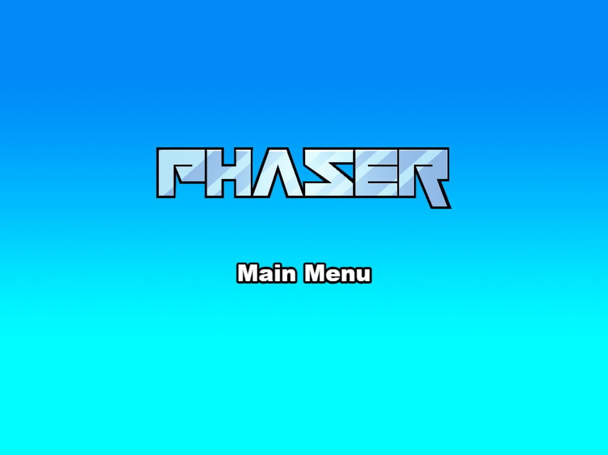

# MOKDO · 속삭이는 숲

평면 2D 캐릭터가 상하좌우로 이동하는 솔로 액션 RPG MVP입니다. 캐릭터와 사물은 발 위치의 Y 좌표로 앞뒤를 정렬합니다. Spring Boot나 PostgreSQL 없이 플레이할 수 있습니다.

## 실행과 플레이 흐름

```sh
npm install
npm run dev-nolog
```

http://localhost:8080 에서 **모험 시작 → 이끼 마을 → 포탈 F → 사냥터 → 동굴 F → 대기실 → 준비 완료 → 보스 던전**으로 진행합니다. PC 키보드·마우스를 기준으로 구현했습니다.

- 마을은 걸어 다닐 수 있는 안전 구역입니다. 동쪽의 숲길 포탈 가까이에서 **F**를 눌러 사냥터로 이동하세요.
- 사냥터 동쪽 위 **수호자의 동굴**에서 **F**를 누르면 대기실로 이동합니다. 서쪽 포탈에서 F를 누르면 전리품을 회수하고 마을로 돌아갑니다.
- 대기실에서 **준비 완료 → 던전 입장**을 누르면 3초 뒤 입장합니다. 준비 취소, 카운트다운 취소, 사냥터 복귀가 가능합니다. 실제 매칭이나 다른 참가자는 없습니다.
- 대기실과 보스방에 있는 동안 사냥터의 몬스터·전리품·전투 시간은 멈춥니다. 보스 결과 화면에서 동굴 입구로 돌아오면 기존 사냥터를 이어서 플레이합니다. 보스가 준 경험치·전리품도 함께 유지됩니다.
- 마을의 **여행자·보관함** 버튼에서 능력치, 전리품, 클리어 기록, 성장 초기화를 확인할 수 있습니다.


### 넓은 맵과 카메라

- 마을은 **2560×1600**, 사냥터는 **3200×1800**, 보스 던전은 **3840×1440** 월드 좌표로 구성됩니다. 화면은 1280×800의 시야이며, 캐릭터를 따라 부드럽게 이동합니다. 맵 가장자리에서는 카메라가 멈춥니다.
- 체력·스킬·상호작용 안내와 미니맵은 화면에 고정합니다. 미니맵의 초록 점은 캐릭터, 금색 점은 포탈·동굴·보스, 테두리는 현재 시야입니다.
- 마을 포탈은 동쪽, 사냥터 동굴은 북동쪽에 있습니다. 기존 리소스의 나무·바위·집을 넓은 맵에 재배치했습니다.

### 보스 던전 진행

1. **입구 전투:** 몬스터 4마리를 모두 처치하면 동쪽 봉인이 풀립니다. 던전 몬스터는 다시 나타나지 않습니다.
2. **가시 통로:** 노란 예고 후 가시가 솟아 피해를 줍니다. 위·아래의 빈 길로 번갈아 이동하거나 가시가 내려간 타이밍에 통과하세요. 회피 무적도 적용됩니다.
3. **수호자의 성소:** 통로 끝에서 보스 공간이 보입니다. 성소 안으로 접근하면 최종 전투가 시작되고 입구가 봉인됩니다. 기존 직선·원형·안전지대 기믹과 보스 전리품을 유지합니다.

던전 입구 몬스터도 경험치와 전리품을 줍니다. 보스 격파 후 정상 복귀하면 입구에 남겨 둔 전리품도 모두 회수합니다. 재도전 시 던전은 입구부터 시작하며, 저장된 성장과 주운 전리품은 유지됩니다.

| 조작 | 기능 |
|---|---|
| WASD / 방향키 | 상하좌우 이동 |
| F / 가까이에서 상호작용 버튼 | 마을 포탈·사냥터 포탈·동굴 이용 |
| J / 필드 클릭 / 공격 버튼 | 기본 공격. J를 누르고 있으면 반복 |
| K / 숲빛 파동 버튼 | 주변 범위 공격. 기본 공격력의 2.5배, 재사용 대기시간 5초 |
| Space / 회피 버튼 | 이동 방향으로 회피. 정지 중에는 마지막 방향 사용. 대기시간 1.6초 |
| E / 주변 줍기 버튼 | 주변 165px 안의 전리품 회수. 38px 이내는 자동 줍기 |
| Esc / 일시정지 버튼 | 일시정지·재개 |
| 회수·마을 복귀 / 회수·보스방 나가기 | 바닥의 남은 전리품을 모두 회수하고 모험 종료 |

### 사냥과 성장

- 사냥터에는 추적·근접 공격을 하는 **새싹 슬라임**과 공격 방향을 예고한 뒤 포자탄을 발사하는 **포자 버섯**이 있습니다. 나무와 바위가 이동과 포자탄을 막습니다.
- 사냥터의 일반 몬스터는 처치 후 14초가 지나고 플레이어가 출현 지점에서 충분히 멀어지면 다시 나타납니다.
- 처치 경험치는 슬라임 18 XP, 버섯 26 XP, 보스 180 XP입니다. 획득 즉시 저장하며 사망해도 유지됩니다.
- 레벨은 1–5, 누적 경험치 기준은 0 / 80 / 210 / 400 / 660입니다. 레벨당 최대 체력 +25, 공격력 +8이며 레벨업 시 체력이 회복됩니다. 쉼터에서 재입장할 때도 최대 체력으로 시작합니다.
- 보스는 권장 Lv. 3이며 낮은 레벨에서도 입장할 수 있습니다. 기존 직선·원형·안전지대 기믹을 유지합니다.

### 전리품

| 대상 | 바닥에 떨어지는 보상 |
|---|---|
| 일반 몬스터 | 2묶음: 골드 3–7 + 숲의 정수 1 또는 빛나는 결정 1 (20%) |
| 보스 | 12묶음: 골드 6묶음 (각 16–24), 빛나는 결정 3묶음 (각 1–3), 숲의 정수 2묶음 (각 3–5), 수호자의 심장 1 |

- 보스는 처치 즉시 결과 화면으로 넘어가지 않습니다. 전리품이 흩어지는 모습을 보고 직접 줍거나 **모두 회수하고 결과 보기**를 선택할 수 있습니다.
- 주운 전리품은 쉼터 보관함과 결과 화면에 표시됩니다. 현재는 수집 재료이며 장비 장착·판매·제작 기능은 없습니다.
- 사망하면 이미 주운 전리품은 유지되지만 바닥에 남은 것은 회수하지 못합니다. 정상 복귀 시에는 남은 물건을 전부 회수합니다.
- 보스 최초 클리어 표시와 누적 클리어 횟수를 저장합니다. 재도전에서도 동일한 보상 종류가 떨어집니다.

### 브라우저 저장

`localStorage`의 `mokdo.solo.v1` 키에 경험치, 전리품, 누적 처치 수, 보스 클리어 수를 자동 저장합니다. 마을 **여행자·보관함**의 **성장 기록 초기화**는 별도 확인 후 이 키만 삭제합니다.

같은 브라우저·사이트 주소에서만 유지됩니다. `localhost`와 `127.0.0.1`은 서로 다른 저장소입니다. 다른 기기와 공유되지 않으며 브라우저 데이터 삭제 시 기록이 사라집니다. 저장이 차단되거나 가득 차면 화면에 안내하고 메모리에서 플레이를 이어갑니다. 전투 위치·몬스터 상태·바닥 전리품은 저장하지 않으므로 새로고침 전에는 복귀해 회수하세요.

## 검증

```sh
npm run typecheck
npm test
npm run build-nolog
```

Node 내장 테스트가 실제 TypeScript 모듈을 메모리에서 변환해 검사합니다. 이동·충돌·기믹뿐 아니라 몬스터 AI, 범위 공격, 레벨업, 드롭 수량·등급, 중복 획득 방지, 저장 복원·초기화·오류 처리를 포함합니다.

수동 확인: 마을에서 포탈까지 이동하고 F를 누르세요. 사냥터에서 동쪽 위 동굴에 접근해 F를 누르고, 준비·취소·던전 입장과 잡몹 전투·가시 통로·최종 보스, 결과 후 동굴 입구 복귀를 확인하세요. 이후 사냥터에서 J와 K로 몬스터를 처치하고 E로 전리품을 주운 뒤 복귀하세요. 쉼터 수량과 레벨을 확인하고 새로고침해 기록 유지를 확인하세요. 보스 격파 후 바닥 보상과 최초 클리어 표시, 재도전, 일시정지, 초기화 취소·확인을 확인하세요.

| 파일 | 역할 |
|---|---|
| `src/game/maps.ts` | 맵 크기·이동 영역·장애물·가시 주기·던전 구간 |
| `src/game/combat.ts` | Phaser와 분리된 이동·전투·몬스터·획득 판정 |
| `src/game/items.ts` | 전리품 정의와 드롭 테이블 |
| `src/game/progression.ts` | 레벨·능력치·저장 데이터 검증·브라우저 저장 |
| `src/game/world.ts` | 숲, 캐릭터, 몬스터의 임시 2D 그래픽 |
| `src/game/navigation.ts` | 포탈·동굴 위치, 접근 범위, 마을 이동 |
| `src/game/scenes/Hub.ts` | 걸어 다니는 마을, 포탈, 캐릭터 상태와 보관함 |
| `src/game/scenes/BossLobby.ts` | 동굴 대기실, 준비 상태, 입장 카운트다운 |
| `src/game/scenes/Game.ts` | 입력, 전투 화면, 드롭 표시와 저장 연결 |
| `src/game/scenes/GameOver.ts` | 결과와 이번 모험 전리품 |

외부 이미지·폰트·API 요청이 필요하지 않습니다. 로그인·멀티플레이는 포함하지 않으며 기존 health API는 유지하지만 게임에서 호출하지 않습니다.

이하 내용은 기반으로 사용한 Phaser 템플릿의 안내입니다.

---

# Phaser Vite TypeScript Template

This is a Phaser project template that uses Vite for bundling. It supports hot-reloading for quick development workflow, includes TypeScript support and scripts to generate production-ready builds.

**[This Template is also available as a JavaScript version.](https://github.com/phaserjs/template-vite)**

### Versions

This template has been updated for:

- [Phaser 4](https://github.com/phaserjs/phaser)
- [Vite 6.3.1](https://github.com/vitejs/vite)
- [TypeScript 5.7.2](https://github.com/microsoft/TypeScript)



## Requirements

[Node.js](https://nodejs.org) is required to install dependencies and run scripts via `npm`.

## Available Commands

| Command | Description |
|---------|-------------|
| `npm install` | Install project dependencies |
| `npm run dev` | Launch a development web server |
| `npm run build` | Create a production build in the `dist` folder |
| `npm run dev-nolog` | Launch a development web server without sending anonymous data (see "About log.js" below) |
| `npm run build-nolog` | Create a production build in the `dist` folder without sending anonymous data (see "About log.js" below) |

## Writing Code

After cloning the repo, run `npm install` from your project directory. Then, you can start the local development server by running `npm run dev`.

The local development server runs on `http://localhost:8080` by default. Please see the Vite documentation if you wish to change this, or add SSL support.

Once the server is running you can edit any of the files in the `src` folder. Vite will automatically recompile your code and then reload the browser.

## Template Project Structure

We have provided a default project structure to get you started. This is as follows:

## Template Project Structure

We have provided a default project structure to get you started:

| Path                         | Description                                                |
|------------------------------|------------------------------------------------------------|
| `index.html`                 | A basic HTML page to contain the game.                     |
| `public/assets`              | Game sprites, audio, etc. Served directly at runtime.      |
| `public/style.css`           | Global layout styles.                                      |
| `src/main.ts`                | Application bootstrap.                                     |
| `src/game`                   | Folder containing the game code.                           |
| `src/game/main.ts`           | Game entry point: configures and starts the game.          |
| `src/game/scenes`            | Folder with all Phaser game scenes.                        | 


## Handling Assets

Vite supports loading assets via JavaScript module `import` statements.

This template provides support for both embedding assets and also loading them from a static folder. To embed an asset, you can import it at the top of the JavaScript file you are using it in:

```js
import logoImg from './assets/logo.png'
```

To load static files such as audio files, videos, etc place them into the `public/assets` folder. Then you can use this path in the Loader calls within Phaser:

```js
preload ()
{
    //  This is an example of an imported bundled image.
    //  Remember to import it at the top of this file
    this.load.image('logo', logoImg);

    //  This is an example of loading a static image
    //  from the public/assets folder:
    this.load.image('background', 'assets/bg.png');
}
```

When you issue the `npm run build` command, all static assets are automatically copied to the `dist/assets` folder.

## Deploying to Production

After you run the `npm run build` command, your code will be built into a single bundle and saved to the `dist` folder, along with any other assets your project imported, or stored in the public assets folder.

In order to deploy your game, you will need to upload *all* of the contents of the `dist` folder to a public facing web server.

## Customizing the Template

### Vite

If you want to customize your build, such as adding plugin (i.e. for loading CSS or fonts), you can modify the `vite/config.*.mjs` file for cross-project changes, or you can modify and/or create new configuration files and target them in specific npm tasks inside of `package.json`. Please see the [Vite documentation](https://vitejs.dev/) for more information.

## About log.js

If you inspect our node scripts you will see there is a file called `log.js`. This file makes a single silent API call to a domain called `gryzor.co`. This domain is owned by Phaser Studio Inc. The domain name is a homage to one of our favorite retro games.

We send the following 3 pieces of data to this API: The name of the template being used (vue, react, etc). If the build was 'dev' or 'prod' and finally the version of Phaser being used.

At no point is any personal data collected or sent. We don't know about your project files, device, browser or anything else. Feel free to inspect the `log.js` file to confirm this.

Why do we do this? Because being open source means we have no visible metrics about which of our templates are being used. We work hard to maintain a large and diverse set of templates for Phaser developers and this is our small anonymous way to determine if that work is actually paying off, or not. In short, it helps us ensure we're building the tools for you.

However, if you don't want to send any data, you can use these commands instead:

Dev:

```bash
npm run dev-nolog
```

Build:

```bash
npm run build-nolog
```

Or, to disable the log entirely, simply delete the file `log.js` and remove the call to it in the `scripts` section of `package.json`:

Before:

```json
"scripts": {
    "dev": "node log.js dev & dev-template-script",
    "build": "node log.js build & build-template-script"
},
```

After:

```json
"scripts": {
    "dev": "dev-template-script",
    "build": "build-template-script"
},
```

Either of these will stop `log.js` from running. If you do decide to do this, please could you at least join our Discord and tell us which template you're using! Or send us a quick email. Either will be super-helpful, thank you.

## Join the Phaser Community!

We love to see what developers like you create with Phaser! It really motivates us to keep improving. So please join our community and show-off your work 😄

**Visit:** The [Phaser website](https://phaser.io) and follow on [Phaser Twitter](https://twitter.com/phaser_)<br />
**Play:** Some of the amazing games [#madewithphaser](https://twitter.com/search?q=%23madewithphaser&src=typed_query&f=live)<br />
**Learn:** [API Docs](https://newdocs.phaser.io), [Support Forum](https://phaser.discourse.group/) and [StackOverflow](https://stackoverflow.com/questions/tagged/phaser-framework)<br />
**Discord:** Join us on [Discord](https://discord.gg/phaser)<br />
**Code:** 2000+ [Examples](https://labs.phaser.io)<br />
**Read:** The [Phaser World](https://phaser.io/community/newsletter) Newsletter<br />

Created by [Phaser Studio](mailto:support@phaser.io). Powered by coffee, anime, pixels and love.

The Phaser logo and characters are &copy; 2011 - 2025 Phaser Studio Inc.

All rights reserved.
